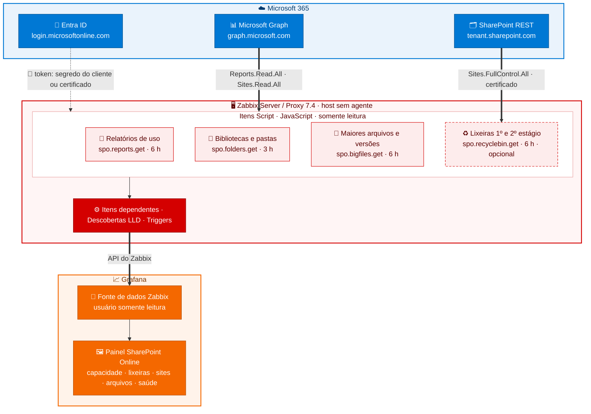

# SharePoint Online – Monitoramento de armazenamento com Zabbix e Grafana

> Autor: **Pablo Pires de Godoi Silva**

Template para **Zabbix 7.4** e painel para **Grafana** que mostram, em um só lugar, **onde está o espaço do SharePoint Online**: uso e cota do tenant, sites, bibliotecas, pastas, maiores arquivos, histórico de versões e lixeiras (1º e 2º estágio).

Toda a coleta é feita pelo próprio Zabbix, com itens do tipo **Script** (JavaScript) chamando o **Microsoft Graph** e a **API REST do SharePoint**. Não precisa de agente, servidor Windows nem tarefas agendadas. **Tudo é somente leitura:** nada é excluído, restaurado ou alterado no tenant.

> Por que existe: o template oficial "SharePoint by HTTP" do Zabbix é para o **SharePoint Server (on-premises)** e não funciona no SharePoint Online. Este projeto cobre o SharePoint Online pelas APIs da Microsoft.

---

## O que é monitorado

| Módulo | O que mostra | Fonte | Intervalo padrão |
|---|---|---|---|
| **Relatórios de uso** | Uso, cota e % do tenant; uso, cota e atividade de cada site; sites excluídos | Graph `reports/getSharePointSiteUsage*` | 6 h |
| **Bibliotecas e pastas** | Tamanho de cada biblioteca de todos os sites; pastas de 1º nível dos sites escolhidos | Graph `drives` (com `$batch`) | 3 h |
| **Maiores arquivos e versões** | Top N maiores arquivos (site, pasta, tamanho, alteração) e top N maiores históricos de versões, com link para o arquivo e a pasta | Pesquisa do Microsoft 365 (`/search/query`) + Graph `versions` | 6 h |
| **Lixeiras** *(opcional)* | Quantidade de itens e tamanho da lixeira de 1º e 2º estágio, total e por site | API REST do SharePoint (`/_api/site/RecycleBin`) | 6 h |

Alertas incluídos: tenant acima de 90% e de 100% da cota (sites em somente leitura), site acima da cota dele, falha em cada coleta, relatório desatualizado e falta de dados.

## Arquitetura



| Etapa | O que acontece |
|---|---|
| 🔑 **Autenticação** | Cada item Script pede um token ao Entra ID. Os itens do Graph usam o **segredo do cliente**; as lixeiras usam **certificado** (JWT RS256 assinado pelo próprio Zabbix). |
| 📥 **Coleta** | Os itens leem o Microsoft Graph e a API REST do SharePoint, **somente leitura**, e devolvem um JSON. |
| ⚙️ **Processamento** | Itens dependentes extraem os valores, as descobertas (LLD) criam itens por site, biblioteca, pasta e arquivo, e as triggers avaliam cota e falhas. |
| 📈 **Visualização** | O Grafana lê o Zabbix pela API, com um usuário só leitura, e monta o painel. |

## Requisitos

| Componente | Versão testada | Observação |
|---|---|---|
| Zabbix Server ou Proxy | 7.4 | Precisa de saída HTTPS para a Microsoft. A leitura das lixeiras usa a função `sign()` do JavaScript do Zabbix, disponível a partir do 7.0 (compilado com OpenSSL). |
| Grafana | 13.2 | Também funciona em versões 11 e 12 recentes. |
| Plugin Zabbix para Grafana | `alexanderzobnin-zabbix-app` (versão atual) | Fonte de dados do painel. |
| Microsoft Entra ID | — | Um App Registration com permissões de **aplicativo** e consentimento do administrador. |

## Conteúdo do repositório

```
.
├── README.md
├── zabbix/
│   └── template_sharepoint_online_graph.yaml   ← template para importar no Zabbix
├── grafana/
│   └── dashboard_sharepoint_online.json        ← painel para importar no Grafana
├── docs/
│   ├── 01-microsoft-entra-id.md                ← app, permissões, segredo, certificado
│   ├── 02-zabbix.md                            ← importação, host, macros, itens, triggers
│   ├── 03-grafana.md                           ← plugin, fonte de dados, usuário, painel
│   ├── 04-solucao-de-problemas.md              ← erros conhecidos e como resolver
│   ├── 05-ferramentas-powershell.md            ← scripts de validação e análise
│   └── 06-seguranca.md                         ← boas práticas e manutenção das credenciais
├── tools/                                      ← scripts PowerShell 7 de validação (somente leitura)
└── src/                                        ← código JavaScript dos itens Script (para revisão)
```

## Início rápido

1. **Microsoft Entra ID:** crie o app, dê as permissões e o consentimento e crie o segredo. Veja [docs/01-microsoft-entra-id.md](docs/01-microsoft-entra-id.md).
2. **Zabbix:** importe `zabbix/template_sharepoint_online_graph.yaml`, crie um host sem interface, vincule o template e preencha as macros obrigatórias. Veja [docs/02-zabbix.md](docs/02-zabbix.md).
3. **Primeira coleta:** em *Dados recentes*, rode **Executar agora** nos itens Script, duas vezes, porque as descobertas criam os itens na primeira execução e preenchem na segunda.
4. **Grafana:** instale o plugin Zabbix, crie a fonte de dados e importe `grafana/dashboard_sharepoint_online.json`. Veja [docs/03-grafana.md](docs/03-grafana.md).
5. **Lixeiras (opcional):** carregue um certificado no app, conceda a permissão do SharePoint e ative `{$SPO.RB.ENABLED}=1`. Veja [docs/01-microsoft-entra-id.md](docs/01-microsoft-entra-id.md#5-certificado-para-a-leitura-das-lixeiras-opcional).

## Permissões necessárias (resumo)

| API | Permissão (tipo **Aplicativo**) | Usada para | Obrigatória |
|---|---|---|---|
| Microsoft Graph | `Reports.Read.All` | Relatórios de uso (tenant e sites) | Sim |
| Microsoft Graph | `Sites.Read.All` | Lista de sites, bibliotecas, pastas, pesquisa de arquivos e versões | Sim |
| SharePoint | `Sites.FullControl.All` | Ler as lixeiras de 1º e 2º estágio de todos os sites | Só para o módulo de lixeiras |

O porquê de cada permissão, e por que as lixeiras exigem certificado e controle total, está em [docs/01-microsoft-entra-id.md](docs/01-microsoft-entra-id.md).

## Limitações conhecidas

- **Atraso dos relatórios:** os relatórios de uso do Microsoft 365 têm atraso de **24 a 48 h**. O uso do tenant no painel não é em tempo real.
- **Índice da Pesquisa:** pode atrasar minutos ou horas em relação aos arquivos.
- **Universo dos maiores históricos de versões:** são os N maiores arquivos acima de um tamanho mínimo (macros `{$SPO.VERSIONS.*}`), não todos os arquivos do tenant.
- **Itens da lixeira:** cada "item" é uma entrada da lixeira. Uma pasta excluída conta como 1 item, e o tamanho dela inclui todo o conteúdo.
- **Somente leitura:** o template não faz limpeza. Exclusão de versões, esvaziamento de lixeiras e purga de sites devem ser feitos à parte, com backup e aprovação.

## Autor

**Pablo Pires de Godoi Silva**: criação, desenvolvimento e documentação do template, do painel e dos scripts.

## Licença

[MIT](LICENSE) © 2026 Pablo Pires de Godoi Silva. Uso, cópia e modificação livres, mantendo o aviso de autoria e a licença.
